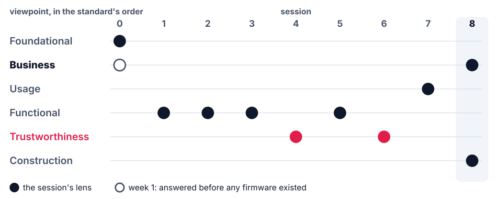
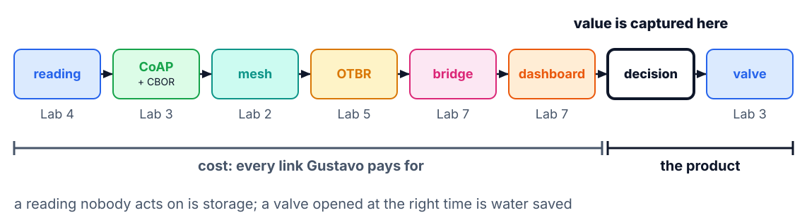
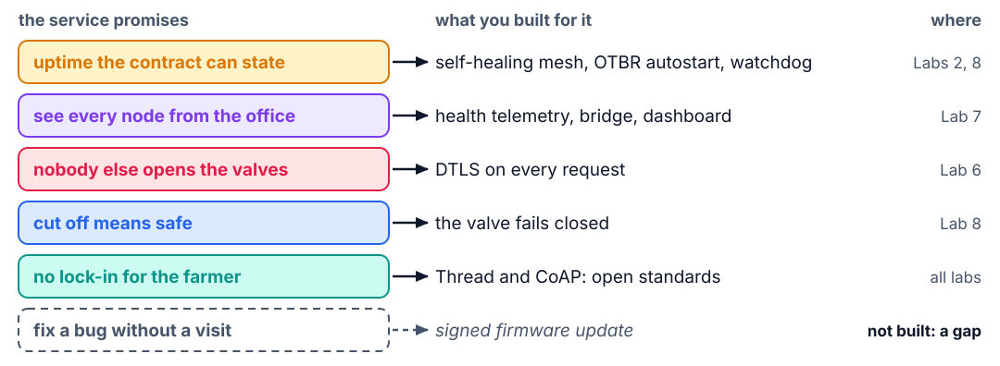
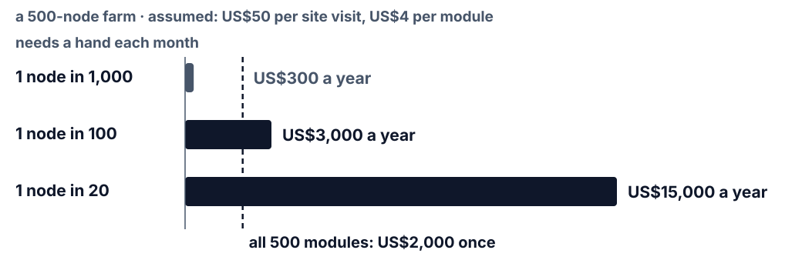
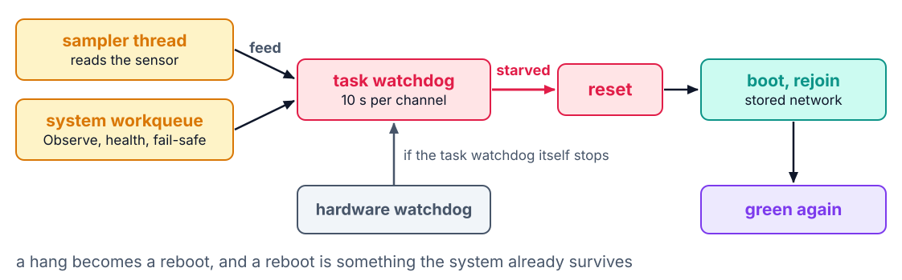

<!--
theme: course
paginate: true
title: Why this system should exist
style: |
  section { --course: #1d4ed8; }
-->

<!-- _class: lead -->
<!-- _paginate: false -->

# Why this system should exist

**Session 8** · the Business viewpoint, answered with the system you built, and the chaos script that decides go or no-go

Samuel will cut the power, flood the nodes and hang the firmware. If someone presses a reset button once, who pays?

<!--
0:00–1:00. Read Samuel's memo from Lab 8: the pilot starts Monday, the contract has a
go/no-go gate, and a pressed reset button fails it. Session 7 ended on "watching is not
acting": the dashboard shows red, but a person still has to drive out. Today: why that
drive is the business question, and why you can now answer the week-1 exercise with
evidence instead of guesses.
-->

---

<!-- _class: agenda -->

## Today

1. **The last lens**: why Business comes last
2. **Value**: where SoilSense earns money
3. **The model**: what a service demands
4. **The bill**: what a hand on a board costs
5. **The contract**: the chaos script
6. **Lab**: predictions; the final project

You'll locate value in your chain, cost a manual reset, and predict how your release recovers.

<!--
1:00–2:00. Reading: ISO/IEC 30141 §6.3 (Business viewpoint, Table 3) and §6.7
(Construction viewpoint, Table 12), plus your own week-1 answer from scenario §8b.
-->

---

<!-- _class: s1 figure -->
<!-- _header: 1 · The last lens -->

## The standard asks why second; this course asked it last

<!--
2:00–5:00. Walk the columns: session 0 set the Foundational view and asked the Business
questions once, as an exercise; Labs 1–3 and 5 climbed the Functional viewpoint's domain
map (Lab 5 through Annex A's gateway pattern); Labs 4 and 6 audited Trustworthiness; Lab 7
read the fleet through Usage. Business and Construction were never the session's lens
until today. In industry the order is reversed: nobody funds a Thread mesh because Thread
is elegant, so the standard lists Business right after Foundational. The course saved it
so you could answer it with evidence. Ask one team to read out what they wrote in week 1.
It will be vague, and that is the point: in week 1 it was speculation; today every claim
can be checked against a system that exists. The Business viewpoint has become an audit.
-->

---

<!-- _class: s2 question -->
<!-- _header: 2 · Value -->

## SoilSense works end to end. Where does GreenField capture value?

1. At the sensor: no reading, no product
2. In the mesh: it's the hardest part to build
3. Where a reading becomes a decision: a valve opens, someone is sent
4. In the cloud: the data is the asset

<!--
5:00–7:30. Vote, pairs, vote again. Answer: C. A and B confuse effort with value: the
sensor and the mesh are necessary and expensive, and nobody pays for them by themselves.
D is "data is the new oil": a reading nobody acts on is a storage bill. Selling
aggregated data is a different business model, with its own value path, and it needs
Daniela's consent: §7 of the DDR.
-->

---

<!-- _class: s2 figure -->
<!-- _header: 2 · Value -->

## Before the decision it's cost; after it, the product

<!--
7:30–10:00. Every box is something a lab built; the colors are the domains from your DDR.
Value is captured where data becomes a decision: the threshold that opens a valve, the
alert that sends a field team. Upstream of that point is cost; from it on is what
Daniela pays for. That is why Gustavo never asked about CBOR and kept asking about
battery life and uptime. Concern 1 of Table 3 in the DDR: draw this chain for your own
system and mark the link where money changes hands.
-->

---

<!-- _class: s3 figure -->
<!-- _header: 3 · The model -->

## Selling a service is a list of capabilities you can point to

<!--
10:00–13:00. Week 1 asked: what if GreenField sold irrigation-as-a-service instead of
boxes? A service is a contract, and each clause needs a capability behind it. Walk the
rows; each one is a lab. The last row is the honest one: nothing in Labs 1–8 updates
firmware in the field. Session 7's picture: signed means the vendor keeps the private key
and each node holds only the public one. A company that can't push a signed update sells
hardware and walks away; one that can keeps maintaining it, and keeps the revenue. In
your DDR that row is either built (the stretch) or a gap with a cost and a plan, never
a claim. Misconception: "as-a-service is a pricing decision". It's an architecture
decision; the price follows.
-->

---

<!-- _class: s3 question -->
<!-- _header: 3 · The model -->

## Gustavo: "Farmers don't care about encrypted soil readings. Ship without DTLS." Which answer wins with him?

1. An eavesdropper could read the soil data
2. Whoever can send a PUT to act/valve can flood a crop, and no farm signs a service contract on that
3. DTLS is industry best practice
4. Removing it wouldn't save anything

<!--
13:00–15:30. Answer: B, a cost argument, in his terms. A is true and he already said he
doesn't care. C is an appeal to authority; it doesn't answer a cost argument. D is false:
Lab 6 measured what DTLS costs (handshake time, 29 B per record, a few sessions per
node), so it does save something. Add: retrofitting security after a pilot costs more
than building it in, and the liability lands on the vendor. Security objections phrased
as cost arguments get cost answers.
-->

---

<!-- _class: s4 figure -->
<!-- _header: 4 · The bill -->

## The hardware is the cheap part; a site visit isn't

<!--
15:30–19:00. Do the arithmetic live; the costs are assumptions, so change them with the
room. A site visit: vehicle plus an hour of a technician, about US$50, whatever the fix.
A C6 module: about US$4. At 500 nodes, one node in 100 needing a hand each month is 60
visits a year: US$3,000, more each year than all the modules cost once. Ask what else
sends someone to the field: dead batteries (Lab 3's poll period sets how often), a hung
node, a valve stuck open. Today's drills measure how many of those your release still
causes. Keep the figure's numbers labelled as assumptions; the DDR wants your own.
-->

---

<!-- _class: s4 -->
<!-- _header: 4 · The bill -->

## Two characteristics, two business decisions

**Scalability**: from three nodes on a desk to 500 on a farm, what changes in your architecture, and what does it cost?

**Interoperability**: if GreenField closes, what still works on Daniela's farm, and what needed GreenField?

<!--
19:00–21:30. Concern 3 of Table 3. Let pairs answer one each for a minute. Scalability
hints: a Thread partition holds at most 32 routers, so most of 500 nodes are children;
the bridge holds one DTLS session per node while a node holds only a few (Lab 6); the
broker is a setting (session 7). Whatever stays fixed as the farm grows is what lets
Gustavo price per node. Interoperability is an exit clause: Thread and CoAP are open, but
check the parts that aren't yours to replace (the key, the bridge, the dashboard). Don't
answer it here: it is the first ethics question in DDR §7, and the business question and
the ethics question turn out to be the same one.
-->

---

<!-- _class: s5 -->
<!-- _header: 5 · The contract -->

## The chaos script is six months of field life in one afternoon

| Drill | In the field | Pass |
|---|---|---|
| Cold start | power returns, any order | green < 120 s |
| Blackout | gateway down 10 min | green < 120 s |
| Parent loss | a router dies | re-routes or fails safe |
| Flood | a hostile client | no reboot |
| Reboots, a hang | brownouts, a bug | back unaided |
| Soak | a night unwatched | 12 h, 0 resets |

<!--
21:30–24:30. Samuel isn't grading firmware; he's simulating the field. Hands off: you
watch only the dashboard and the logs, and the drill's own action is the only thing that
touches hardware. Every drill that needs a hand is a site visit from the last segment.
SOP-08 §4 has the exact actions. Lab 8 Task A asks which line of the Golden Master
answers each drill: read the source, don't guess from the names.
-->

---

<!-- _class: s5 figure -->
<!-- _header: 5 · The contract -->

## A watchdog turns a hang into a reboot

<!--
24:30–26:30. Two loops must check in at least every 10 s: the sampler thread and the
system workqueue, which also carries the Observe policy, the health report and the
valve's fail-safe. Starve either and the task watchdog resets the node; if the task
watchdog itself stops, the C6's hardware watchdog does it. A reboot is safe because
the Golden Master rejoins its stored network at boot and the mesh heals around it (Lab 2). Drill 5's `health stall` blocks the
workqueue on purpose. Misconception: a watchdog fixes bugs. It hides them from the
field and shows them in the log; the reset count on the dashboard is the bug report.
-->

---

<!-- _class: s5 question -->
<!-- _header: 5 · The contract -->

## A node's valve is open. At t = 0 you cut it off from every neighbour. LAB_FAILSAFE_S = 30. When does the valve close?

1. At t = 10 s: the watchdog resets the node
2. At t = 30 s
3. A few minutes in: the 30 s start when Thread gives up on the neighbours
4. Never: with no network, nothing can send the close

<!--
26:30–29:00. Answer: C. The fail-safe counts from the moment the node has no neighbour
at all, and Thread takes time to decide its links are dead: the advertisement timeout
from Lab 2. A treats the watchdog as a network monitor; it only watches the node's own
loops, which are fine. B forgets that the node can't tell "cut off" from "a quiet
second". D is the point of a fail-safe: the node closes the valve itself. Lab 8 Task B
measures both parts from the timestamps; ADR-008 picks the delay: too short closes the
valve on every mesh hiccup, too long floods the field.
-->

---

<!-- _class: s5 question -->
<!-- _header: 5 · The contract -->

## Each client may send 8 requests per 10 s. The bridge and test_e2e.py run on the same laptop. What does a node see?

1. Two clients, 8 requests each
2. One client: they share the 8, and either can get 4.29
3. The bridge is exempt: it only observes
4. Two clients: each has its own DTLS session

<!--
29:00–31:00. Answer: B. The Golden Master counts per source address, and both tools
leave the laptop with the same one. C is half right: Observe notifications don't count,
but each registration does. D: the session is per port, the
limit is per address. So a tight limit can block your own bridge: ADR-008 has to weigh
that against the flood it stops. SOP-08 says to stop the bridge during the e2e burst.
-->

---

<!-- _class: s5 -->
<!-- _header: 5 · The contract -->

## The Golden Master: one binary, named, with the key outside it

- Every node boots `SoilSense Golden Master v1.0.0`
- The DTLS key lives in `secrets.conf`, which git ignores
- The binary that passed the drills is the one that ships

<!--
31:00–33:00. The version line is how Samuel knows which binary he tested, and how Edwin
will know which one is in the field. The key: session 7 showed one stolen node gives a
shared key to all of them; at least keep it out of the repository. ADR-008 asks where it
should live in production: leave it to them. DDR first-principles question 3 asks why
"no new features" is a feature in the last week: pose it, don't answer it.
-->

---

<!-- _class: takeaway -->

## The one thing to remember

> Why this system should exist is a claim like any other: back it with a measurement from your own boards.

<!--
33:00–34:00. First line of today's DDR entry. The engineer says how it works; the
architect says why it's worth building, and shows the numbers.
-->

---

<!-- _class: s6 -->
<!-- _header: 6 · Lab -->

## Today in the lab

| You measure | Predict now | Target |
|---|---|---|
| Cold start → all green | ____ s | < 120 s |
| OTBR back → all green | ____ s | < 120 s |
| Cut off → valve closed | ____ s | < 180 s |
| Hang → back on the dashboard | ____ s | < 120 s |
| Stress: served, average latency | ____ % · ____ ms | ≥ 80 % |
| First 4.29 at request | ____ | limit + 1 |
| Soak: hours, unplanned reboots | ____ | ≥ 12 h, 0 |

<!--
34:00–37:30. Predictions are due before the drills. Lab 8 runs two sessions: today
Tasks A and B and the first drills; the soak runs overnight. Each team builds with its
own key in secrets.conf: hand them out now. Stop the bridge during the e2e burst
(SOP-08 troubleshooting). Task E re-answers the week-1 exercise with these numbers.
-->

---

<!-- _class: s6 -->
<!-- _header: 6 · Lab -->

## The final project asks the same question, in front of a panel

- Lead with the problem and who pays; the system is the evidence
- Track A: your Golden Master · Track B: a system you built elsewhere
- A Business Case of 3–5 pages, then a 15-minute pitch with a live demo
- Deadlines: [final project](../docs/final_project.md) §6

<!--
37:30–39:00. The panel is an investor, a customer and an architect (Table 3's
stakeholders), played by the instructor and classmates. Each team also sits on two
panels. The pass/fail gate: the demo must run. Give the track declaration date now.
-->

---

## References

- ISO/IEC 30141:2024 §6.3 (Business, Table 3) · §6.7 (Construction, Table 12)
- RFC 8516 (4.29 Too Many Requests) · [Zephyr task watchdog](https://docs.zephyrproject.org/latest/services/task_wdt/index.html)
- [Week-1 exercise](../docs/scenario.md#8b-business-viewpoint-exercise-isoiec-30141-section-63) · [Lab 8](../labs/lab8.md) · [SOP-08](../labs/sops/sop08_golden_master.md) · [Final project](../docs/final_project.md)

<!--
39:00–40:00. Questions, then the lab.
-->
